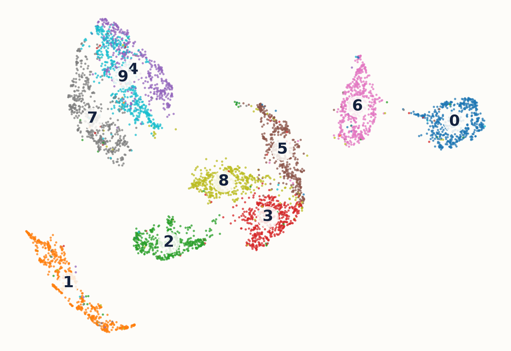
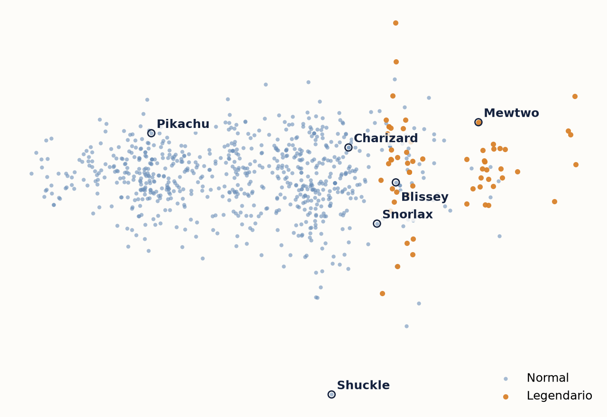

# Reducción de dimensionalidad: PCA, t-SNE y UMAP

Casos de estudio de la exposición de Sistemas Inteligentes (UTPL), basados en los ejemplos de la semana 6.
Autores: Omer Benitez y Luis Leon.

| Caso | Datos | Script |
|---|---|---|
| MNIST | 5.000 dígitos escritos a mano, 28×28 píxeles = 784 variables | `mnist.py` |
| Pokémon | 800 Pokémon, 6 estadísticas base | `pokemon.py` |

## Cómo correrlo

Requiere Python 3.10 o superior.

```bash
pip install -r requirements.txt
python pokemon.py   # unos 45 s
python mnist.py     # unos 3 min; descarga MNIST (11 MB) la primera vez
```

En Windows, si `python` no funciona, prueben con `py pokemon.py`.

Cada script imprime los resultados en la terminal y abre una ventana con los tres gráficos.
La primera llamada a UMAP compila código y tarda más: los scripts la hacen antes de medir, y ese tiempo no se cuenta.

## Resultados (random_state = 42)

**MNIST**: PCA a 50 componentes antes de t-SNE y UMAP.

| Método | Tiempo | Vecinos conservados |
|---|---|---|
| PCA | 0,1 s | 0,74 |
| t-SNE | 23,8 s | 0,98 |
| UMAP | 5,7 s | 0,96 |

Con 2 componentes, PCA conserva el 16,7 % de la varianza; con 50, el 83 %. Para el 90 % hacen falta 86.

K-means con 10 grupos (ARI, 1 = perfecto): 784 píxeles 0,36 · PCA 50 0,36 · PCA 2D ≈ 0,24 · UMAP 2D ≈ 0,66 (puede variar ±0,01 entre ejecuciones).
t-SNE no se usa para K-means, porque sus distancias no tienen significado.



**Pokémon**: datos estandarizados.

- PC1 (45 %): todas las cargas positivas, mide el poder total.
- PC2 (18 %): velocidad (+0,67) frente a defensa (−0,63).
- Por el criterio de Kaiser se conservan 2 componentes (autovalores 2,72 y 1,10).
- Vecinos conservados: PCA 0,87 · t-SNE 0,97 · UMAP 0,96.
- Los legendarios se separan solos, aunque ningún método usó esa columna.



Los tiempos dependen de cada computadora.

## Fuentes de datos

- MNIST: LeCun, Cortes y Burges, vía [keras.datasets.mnist](https://keras.io/api/datasets/mnist/).
- Pokémon: [Pokemon with stats](https://www.kaggle.com/datasets/abcsds/pokemon) (Kaggle).
